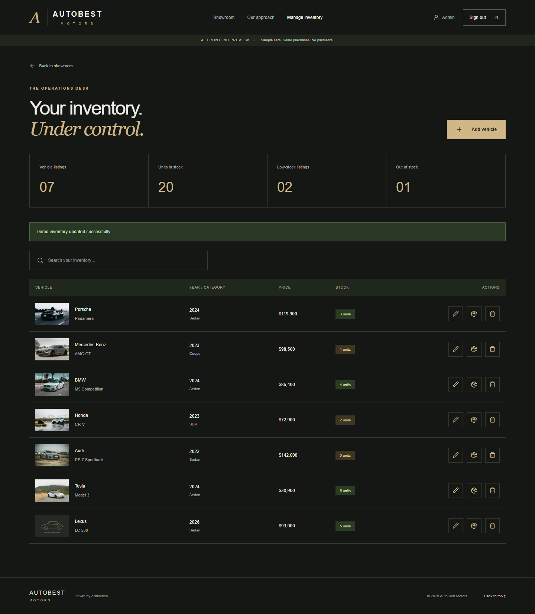
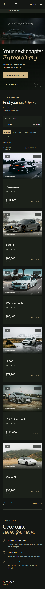

# AutoBest Motors

A cinematic, scroll-driven car dealership frontend built with **HTML5, CSS3, Tailwind CSS, React, Vite, React Router, an auth context, and an isolated API client**. The supplied AutoBest film opens the experience with only the dealership name in the video visible. Pointer-reactive vehicle cards reveal an accessible same-page detail dialog.

**Architecture**: Full-stack application featuring a React/Vite/Tailwind frontend and a hardened **Node.js + Express 5 + SQLite (`better-sqlite3`)** RESTful backend API prepared for MVP deployment.

## Run locally

Use Node.js 22.12 or later and npm.

### 1. Backend Setup & Startup

The backend runs on port 8000 by default and connects to a persistent SQLite database (`data/autobest.sqlite`).

```sh
cd backend
npm install
npm run seed      # Seeds admin (admin@autobest.com / AdminSecurePass123!) and 6 vehicles in dev
npm start         # Runs Express server at http://localhost:8000
```

To run backend tests and inspect coverage:

```sh
cd backend
npm test              # Runs 78 passing unit, security, and integration tests
npm run test:coverage # Computes test coverage report (~88% line coverage)
```

### 2. Frontend Setup & Startup

In a separate terminal at the project root:

```sh
npm ci
npm run dev       # Starts Vite dev server on http://localhost:5173
```

To connect the frontend directly to the live Node.js backend API:

Create a `.env.local` file (or update `.env`) with:

```dotenv
VITE_API_MODE=live
VITE_API_BASE_URL=http://localhost:8000/api
```

Restart the Vite dev server. The frontend will now communicate directly with the live Express backend API, authenticating against the persistent SQLite database.

Default development administrator credentials:
- **Email**: `admin@autobest.com`
- **Password**: `AdminSecurePass123!`

---

## Operations & MVP Deployment Readiness

This backend is structured and hardened for an **MVP deployment**. It enforces defense-in-depth principles without introducing heavyweight cloud infrastructure dependencies.

### 1. Environment Configuration

Copy `backend/.env.example` to `backend/.env` for local configuration. In production environments, configure these environment variables via your container or hosting platform:

| Variable | Requirement | Default (Dev) | Description |
| :--- | :---: | :---: | :--- |
| `NODE_ENV` | Optional | `development` | Set to `production` for live deployments. |
| `PORT` | Optional | `8000` | HTTP listening port for Express. |
| `JWT_SECRET` | **Required in Prod** | Dev default | Cryptographic secret for signing JWTs. Must be **at least 32 characters** in production. Server aborts startup if missing or weak. |
| `JWT_EXPIRES_IN` | Optional | `24h` | Token expiration duration (e.g. `24h`, `7d`). |
| `CORS_ORIGIN` | **Required in Prod** | Local Vite ports | Comma-separated list of allowed frontend origins (e.g. `https://autobest.example.com`). Browser cross-origin requests from unlisted origins are rejected with HTTP 403 `CORS_ERROR`. |
| `DATABASE_PATH` | Optional | `data/autobest.sqlite` | SQLite database file location. |
| `ADMIN_EMAIL` | Optional | `admin@autobest.com` | Production administrator email. |
| `ADMIN_PASSWORD` | Optional | None in Prod | Production administrator password. Must be **at least 12 characters** and **cannot use published sample passwords**. If omitted in production, automatic admin creation is skipped for security. |

### 2. Startup Behavior & Fail-Safe Controls

1. **Configuration Validation**: On startup (`server.js`), `validateConfig()` inspects all environment variables. If running in `production` and `JWT_SECRET` is missing/under 32 characters, `CORS_ORIGIN` is empty, or `ADMIN_PASSWORD` matches the published default, the process immediately exits with code `1` and prints an explicit error before binding to network ports.
2. **Versioned Database Migrations**: Before accepting traffic, the server runs `runMigrations(db)`, executing pending migrations tracked in `schema_migrations`.
3. **Safe Administrator Seeding**: In production, the backend will refuse to create an admin account with default credentials. If admin credentials are not supplied, admin account creation is skipped and can be provisioned via administrative scripts.

### 3. Database Location & Backup Considerations

- **Storage Engine**: SQLite with Write-Ahead Logging (`WAL`) mode enabled for concurrent reads and atomic writes.
- **File System Persistence**: SQLite stores data in `DATABASE_PATH` (`data/autobest.sqlite`). In Docker or Kubernetes, mount the directory hosting the database file to a persistent storage volume.
- **WAL Backup Hygiene**: In WAL mode, SQLite generates `-wal` and `-shm` sidecar files. For live backups without downtime, use SQLite's online backup API or execute `VACUUM INTO '/backups/autobest-backup.sqlite'` rather than raw file copies, preventing partial-write corruption.

### 4. API Hardening & Security Controls

- **Defensive Headers**: Enforces `X-Content-Type-Options: nosniff`, `X-Frame-Options: DENY`, `Referrer-Policy: strict-origin-when-cross-origin`, `Cross-Origin-Opener-Policy: same-origin`, `Cross-Origin-Resource-Policy: same-origin`, and `Strict-Transport-Security` in production. Suppresses `X-Powered-By`.
- **Payload Size Limits**: Limits incoming JSON requests to `50kb` (`express.json({ limit: '50kb' })`) to defend against memory exhaustion and payload-based DoS.
- **Rate Limiting**: Throttles `/api/auth/login` and `/api/auth/register` to prevent credential stuffing and brute-force attacks (`429 RATE_LIMIT_EXCEEDED` with `Retry-After` header).
- **Graceful Error Handling**: Intercepts malformed JSON syntax errors and returns HTTP 400 `INVALID_JSON`. In production, unexpected internal server errors (500) suppress stack traces and database error dumps to prevent information leakage.
- **Strict Input Validation**:
  - Whitelists categories (`Sedan`, `SUV`, `Coupe`, `Hatchback`, `Convertible`, `Truck`).
  - Enforces currency precision on vehicle prices (positive numbers up to $10,000,000 with at most 2 decimal places).
  - Sanitizes and bounds search filters (`min_price <= max_price`, non-negative bounds).
  - Enforces alphanumeric vehicle ID patterns (`/^[a-zA-Z0-9_-]{1,64}$/`), blocking path traversal attempts.

### 5. Architectural Boundary: Stock Decrement vs Full Order Workflow

The existing backend is scoped as a vehicle inventory management and reservation system:
- `POST /api/vehicles/:id/purchase` executes an **atomic conditional stock decrement**:
  ```sql
  UPDATE vehicles SET quantity = quantity - ? WHERE id = ? AND quantity >= ?;
  ```
  If stock is zero or insufficient, an HTTP `409 Conflict` (`OUT_OF_STOCK`) is returned.
- **Explicit Launch Boundary**: This endpoint decrements inventory in the catalog. It is **not** an end-to-end ecommerce checkout. It deliberately does not include payment processing (Stripe/PayPal), credit card capture, order records, invoicing, sales tax, shipping calculation, customer order histories, or webhook signature verification. Launching a transactional payment system will require implementing separate `orders` and `transactions` tables, payment gateway webhooks, and idempotency key handling.

---

## Features

- Local 1080p opening video with no text layered over the dealership name, a lightweight poster, play/pause/replay controls, and reduced-motion support.
- Responsive vehicle cards, manufacture year, stock, category, price, photo, multidirectional pointer tilt and “Click to know more” hover prompt.
- Native modal dialogs with Escape dismissal, focus containment, focus restoration and preserved page position.
- Registration, login, logout, field validation, duplicate-email feedback, protected routes, bearer token support and expired-session handling.
- Debounced make/model/category/price search, range validation, clear filters, sorting, loading skeletons, empty states, network errors and retry.
- Purchase controls on every card, zero-stock disabling, confirmation, pending state, stock refresh and specific 409 conflict feedback.
- Admin add, edit, confirmed delete and positive-integer restock; customer access restrictions; inventory totals and management search.
- All essential controls work without hover, with labels and visible keyboard focus.

The public homepage shows three **static editorial sample vehicles**. Protected inventory is fetched only after sign-in. `GET /vehicles` includes zero-stock listings so disabled purchase states remain visible. All inventory write controls except purchase are admin-only.

## Structure

```text
backend/
├── src/
│   ├── config/        # Environment validation & fail-safe rules
│   ├── controllers/   # Request/response mapping and HTTP status codes
│   ├── db/            # SQLite connection, versioned migrations, and seeder
│   ├── middleware/    # JWT verification, RBAC guard, rate limiting, security headers, error handler
│   ├── repositories/  # Database access queries (UserRepository, VehicleRepository)
│   ├── routes/        # Express router declarations (authRoutes, vehicleRoutes)
│   ├── services/      # Business logic, atomic transactions, domain rules
│   ├── utils/         # Input validators and sanitizers
│   ├── app.js         # Express app factory with dependency injection
│   └── server.js      # Server entrypoint with auto-seeding
└── src/tests/         # TDD & security test suites (config, security, migrations, auth, catalog, crud, inventory, E2E)

src/components/        # React components (Hero, inventory, vehicle cards, admin)
src/lib/               # HTTP client adapter, demo adapter, auth context
docs/                  # API contract, test reports, and visual screenshots
```

## Screenshots





## Test report

- Frontend tests: See [TEST-REPORT.md](docs/TEST-REPORT.md) for verified frontend results.
- Backend tests: See [BACKEND-TEST-REPORT.md](docs/BACKEND-TEST-REPORT.md) for verified backend results. **78 tests across 9 test suites passing** with ~88% code coverage. Strict TDD was followed with explicit **Red-Green-Refactor** commits for database migrations, authentication, catalog search, vehicle management CRUD, and inventory concurrency operations.

## My AI Usage

**Tools used:**
1. **OpenAI Codex (ChatGPT)**: Used during the frontend phase for UI scaffolding, component layouts, and browser journeys.
2. **Google Gemini**: Used during the backend phase for requirement analysis, test-driven development (TDD), generating test suites, implementing service and repository layers, and structuring clean git commits following the Red-Green-Refactor pattern.

**How AI was used:**
- **Architecture & API Design**: Gemini mapped the technical requirements into a layered architecture (Controllers → Services → Repositories → SQLite).
- **Test-Driven Development (TDD)**: Before implementing any backend logic, failing specification tests (Red) were written and committed for each module: database schema, authentication, catalog search, vehicle CRUD, and atomic purchase/restock.
- **Implementation (Green)**: Minimal robust code was implemented to satisfy the test assertions, verify HTTP status codes (200, 201, 204, 400, 401, 403, 404, 409), and enforce business rules.
- **Refactoring (Refactor)**: Code was cleaned, parameter sanitization was extracted into validator utilities, and database abstraction was modularized while ensuring test suites remained 100% green.
- **Security Hardening**: Gemini identified and remediated CORS allowlist enforcement, removed unsafe secret fallbacks, integrated security headers, added rate limiting for authentication endpoints, enforced payload bounding, and masked internal errors.
- **End-to-End Integration**: AI generated an end-to-end integration test verifying full customer and administrator journeys.

**Workflow reflection:**
AI significantly accelerated development by automating repetitive boilerplate and formulating rigorous test suites before implementation. Adhering to the Red-Green-Refactor discipline ensured each layer was verified independently, preventing regressions and edge cases such as stock-decrement race conditions and privilege escalation during registration.

Every AI-assisted commit includes the required `Co-authored-by` trailer (`Co-authored-by: Gemini <AI@users.noreply.github.com>`). All raw user prompts and chat requests are recorded verbatim in [PROMPTS.md](PROMPTS.md).

## Media credits and sample data

`public/media/hero.mp4`: user-supplied AutoBest Motors opening animation, included unchanged. It plays muted without preloading the full file. Account and administrator pages are loaded only when opened to keep the first page load light.

Local sample images from Unsplash image CDN (illustrative, not verified sale listings):

- Porsche: https://images.unsplash.com/photo-1503376780353-7e6692767b70
- Mercedes-Benz: https://images.unsplash.com/photo-1618843479313-40f8afb4b4d8
- BMW: https://images.unsplash.com/photo-1555215695-3004980ad54e
- Honda: https://images.unsplash.com/photo-1519641471654-76ce0107ad1b
- Audi: https://images.unsplash.com/photo-1606152421802-db97b9c7a11b
- Tesla: https://images.unsplash.com/photo-1560958089-b8a1929cea89

All years, prices, stock counts and specifications are fictional demonstration values, not vehicle provenance claims. Replace them with verified inventory before launch. Currency is USD for the sample; the backend contract must agree on currency before launch.
